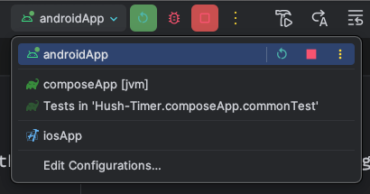

# Gettings Started

This is the development guide for HUSH Timer. Join our [Discord Server](https://discord.gg/GjfMKprt7q) and request repository access and `developer` role from the owner before reading this page.

## Setup

### Clone Repository

Clone the HUSH Timer [repository](https://github.com/ricky9667/HushTimer).

```shell
git clone git@github.com:ricky9667/HushTimer.git
```

### Setup IDE

- Download [Android Studio](https://developer.android.com/studio) and open the cloned project.
- Install [Kotlin Multiplatform Plugin](https://plugins.jetbrains.com/plugin/14936-kotlin-multiplatform) to your IDE. Go to **Settings > Plugins** and search `Kotlin Multiplatform`, then click `Install`.
- Restart your IDE to activate the plugin.

---

## Execution

### Prerequisites

- Make sure Java 21+ is installed. Eusure by running `java -version` in your command line.

- Get the secret keys from owner, add them to your `local.properties` file. Then run `./gradlew generateBuildKonfig` so that the project can resolve generated `BuildKonfig` class.

```text
sdk.dir= ...
CONFIGCAT_KEY_TEST=...
CONFIGCAT_KEY_PROD=...
```

### Run the app

- Run gradle sync by clicking this gradle button  on the top right of the IDE, or go to `build.gradle.kts` file and click **Sync Now** that shows on top.

- Select the platform to run on the top right toolbar.
    - `androidApp`: Android
    - `iosApp`: iOS
    - `composeApp [jvm]`: Desktop



- 💡 Note: **It is required to build iOS version with a macOS device**. All desktop environments support building Android and JVM platforms.

---

## Contribution

Here are some things you should know before contributing:

### Version Control

**1. Version control flow**

- The project uses [trunk-based development](https://trunkbaseddevelopment.com/), feature branches are branched out from the trunk branch `master`. A pull request is required if you want to merge a branch, and the branch should be deleted after PR merge.
- Only the trunk branch `master` and `release/` branches are long-lived branches, therefore release branches should not be deleted after merge.

**2. Branch Naming**

- Name your branch with the prefix `<tag>/`, as the `tag` refers to the conventional commits mentioned in the previous section.
For example:
    - `feat/integrate-tnoodle-scramble`
    - `fix/screen-auto-turn-off-issue`

- If you know the ticket number of this task, add it to the second section of the branch name. 
For example:
    - `feat/HUSH-46/implement-revenuecat-billing`

- If you are preparing a release, branch out with the `release` prefix. The branch should not be deleted after merge.
For example:
    - `release/1.5.0`

**3. Use [Conventional Commits](https://www.conventionalcommits.org/en/v1.0.0/) when committing changes.**

- Add a `<tag>:` before your commit better for others to understand what you did.

- Here are the commit tags you can add:

    - `feat`: New feature (triggers minor SemVer bump).
    - `fix`: Bug fix (triggers patch bump).
    - `docs`: Documentation changes.
    - `style`: Code style/formatting (no production code change).
    - `refactor`: Code restructuring without feature/bug changes.
    - `perf`: Performance improvements.
    - `test`: Tests only.
    - `build`: Build tool/dependency changes.
    - `ci`: CI configuration.
    - `chore`: Misc (e.g., .gitignore).

You can use tools such as [git-cz](https://github.com/streamich/git-cz) (which we mainly use), the Oh My Zsh [git-commit](https://github.com/ohmyzsh/ohmyzsh/tree/master/plugins/git-commit) plugin, or anything you prefer.

### Linting

HUSH Timer uses pure [ktlint](https://github.com/pinterest/ktlint) as our default linter and formatter, as well as using it as a pre-commit hook.

Before developing and committing your changes, you have to install [ktlint](https://github.com/pinterest/ktlint) and [pre-commit](https://pre-commit.com/#install) first. If you're using a macOS device, install from [Homebrew](https://brew.sh/):

```shell
brew install ktlint pre-commit
```

Then install the pre-commit hook to your dev device:

```shell
pre-commit install
```

---

## Useful Plugins & Tools

- [Kotlin Multiplatform Plugin](https://plugins.jetbrains.com/plugin/14936-kotlin-multiplatform): Required for KMP development

- [Koin Dependency Injection Plugin](https://plugins.jetbrains.com/plugin/26131-koin-dependency-injection-official-): Koin DI plugin that makes it easier to trace DI classes. The plugin shows a Koin icon for classes that are injected or being injected.

- [Compose Stability Analyzer](https://plugins.jetbrains.com/plugin/28767-compose-stability-analyzer): Shows the indicator on `@Composable` function parameters if they are stable/runtime/unstable. Good for understanding Compose performance and recompositions.

    

- [Compose Navigation Graph](https://plugins.jetbrains.com/plugin/32224-compose-navigation-graph): Visualizes your Jetpack Compose navigation graph like XML. Good for previewing screens and navigation routes.

    
