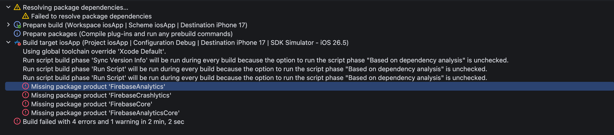

# Troubleshooting

Here are some frequently encountered issues during development which can save you some time to search for solutions.

## iOS build fail missing packages

This problem is caused by unresolved Firebase packages that are configured in Xcode, which happens once in a while when you did not build HUSH Timer iOS on your computer.



### 1. Resolve Xcode Packages (~30 seconds)

When Android Studio throws a missing package error, SPM has likely dropped the ball in the background.

Action: Open the iOS project in **Xcode -> File > Packages > Resolve Package Versions**.

Why it works: It forces Xcode to re-check the `Package.resolved` file and fetch missing targets like FirebaseAnalyticsCore.

### 2. Cache Clear (1-2 minutes)

If resolving packages doesn't work, Xcode's caching mechanism (Derived Data) might be corrupted.

Actions:

1. Open Xcode.
2. Go to **Product > Clean Build Folder** (Cmd + Shift + K).
3. Run **Resolve Package Versions** from *Solution 1*.
4. Build the iOS App from Xcode.
5. Rebuild iOS from Android Studio if the previous step build successfully. If not, run **File > Invalidate Caches** and restart in Android Studio.

### 3. Manually delete Xcode derived data (3-5 minutes)

If the project completely refuses to acknowledge the packages, you need to wipe the Derived Data entirely and force a fresh Gradle sync.

Actions:

1. Delete Xcode's Derived Data folder. (See automation tip below).
2. In Android Studio, run Build > Clean Project.
3. Run File > Sync Project with Gradle Files.
4. Open Xcode, allow it to re-index and resolve packages automatically.
5. Build again.

If you want to do this automatically, you can create the custom command:

```shell
alias nuke_ios="rm -rf ~/Library/Developer/Xcode/DerivedData/* && echo 'Xcode Derived Data cleared!'"
```
