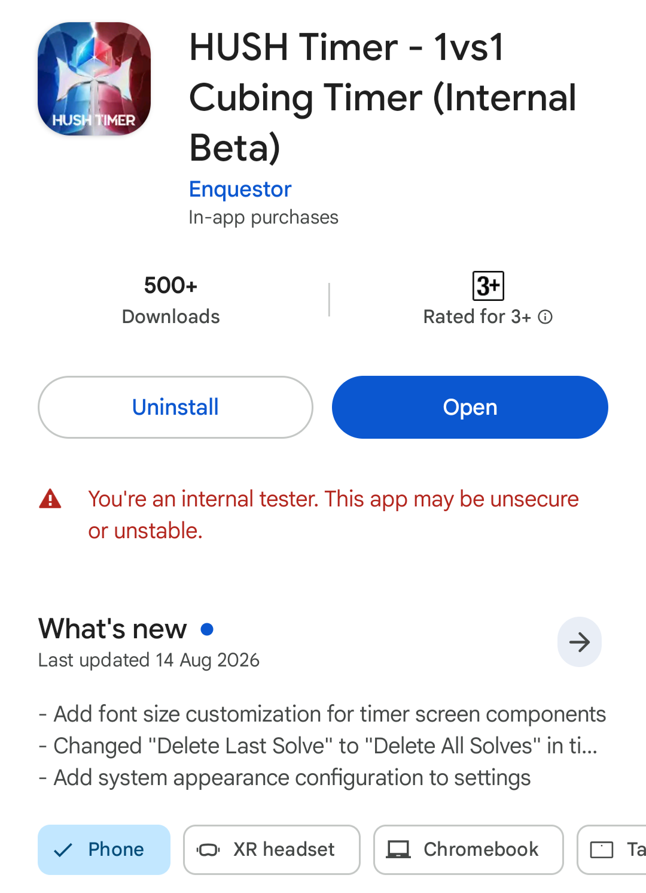
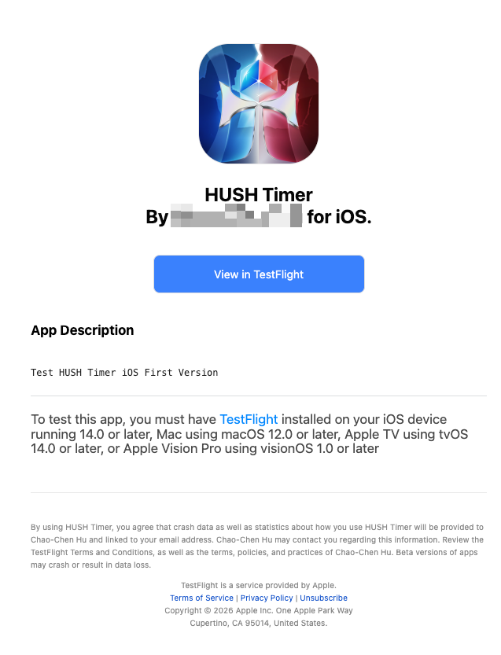
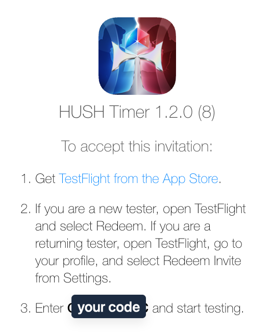

# Testing Guide

This is the testing guide for HUSH Timer. Join our [Discord Server](https://discord.gg/GjfMKprt7q) and request repository access and `tester` role from the owner before reading this page.

## 1. Access internal testing app

### Google Play (Android)

Provide the **email account** that you logged in to Google Play.

The account holder will add you to the internal testing track, Google Play will indicate that you are an *internal tester* on the HUSH Timer app page.

??? info "Google Play"
    

You can download the pre-released testing app directly from Google Play.

### App Store (iOS)

Provide your **apple email account** that you login in your settings app. You will see this email that indicates that you are invited to the testing group.

??? info "Invitation email"
    

Next, download [TestFlight](https://apps.apple.com/us/app/testflight/id899247664) from App Store, and go back to this email to click *View In Testflight*, it leads you to the TestFlight app to download the pre-released testing app.

You will also receive another email like this below, which provides you a redeem code to download the testing app. The code can only be used by one person, do not give this redeem code to another user.

??? info "Redeem code email"
    

Copy the code and open TestFlight, click the left sidebar and click your avatar, click **Redeem Invite**, and paste the code you copied earlier.

## 2. Test the app

When a new release is going to be published, the admin will send a pre-release message in `testing` the channel.

Normally, the testing time span lasts about a week, take your time to play arond the app and see if there are any issues or improvements, and discuss with the developers in the `development` channel.

## 3. Release public version

After user testing from @tester group, the admin will notify the app release in the public `releases` channel.

